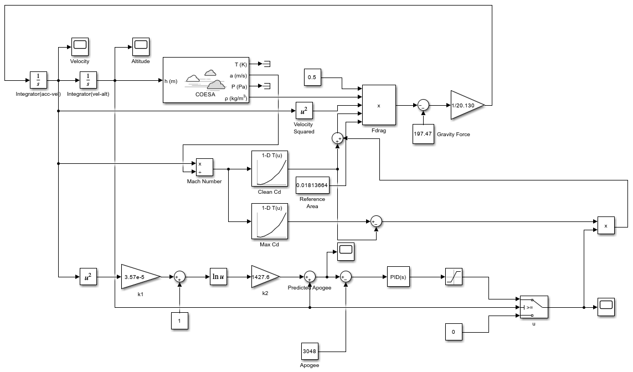

# Active Airbrake Control & Apogee Prediction System

MATLAB/Simulink flight dynamics and control simulation targeting a **10,000 ft (3,048 m)** apogee for a sounding rocket during the unpowered coast phase. The model combines a 1-DOF vertical flight physics plant, a COESA atmosphere model, Mach-dependent drag lookup tables derived from OpenRocket data, real-time apogee prediction, and closed-loop airbrake control.

---

## System Overview

| Subsystem | Implementation Details |
| :--- | :--- |
| **Target Apogee** | 10,000 ft (3,048 m), past a 2,000 m safety threshold |
| **Flight Regime** | Coast phase (motor burnout to apogee), constant dry mass ($m_{\text{dry}}$) |
| **Equations of Motion** | 1-DOF vertical dynamics: $a(t) = \frac{-m_{\text{dry}} g - F_{\text{drag}}}{m_{\text{dry}}}$ |
| **Atmosphere Model** | COESA atmosphere for altitude-dependent air density ($\rho$) and speed of sound |
| **Aerodynamic Drag** | $F_{\text{drag}} = \frac{1}{2}\rho(h)\,v^2\,C_d(M, \alpha)\,A_{\text{ref}}$ using OpenRocket Mach lookup data |
| **Control & Actuation** | Closed-loop control / PID & PD law with saturation and servo dynamics modeling |
| **Sensor & Hardware Realism** | Measurement noise filtering, low-pass conditioning, and actuator rate/position limits |

---

## Architecture & Modeling Workflow

1. **1-DOF Physics Plant & Atmosphere:**
   - Integrates net vertical acceleration ($F_{\text{net}} = -F_{\text{gravity}} - F_{\text{drag}}$) from burnout initial conditions to obtain velocity and altitude.
   - Uses COESA atmospheric properties and OpenRocket drag data across Mach regimes to capture drag rise accurately rather than relying on sea-level constants.
2. **Apogee Prediction & Control Law:**
   - Evaluates real-time apogee projection and compares current state/trajectory error to command airbrake deployment ($0\% \to 100\%$) while respecting actuator limits and safety bounds.
3. **Noise & Actuator Realism:**
   - Incorporates sensor noise, filtering, and actuation limits/lag so control behavior can be evaluated under realistic flight conditions.

---

## Repository Contents

- `simulink/AirbrakesPhysics.slx` — Simulink flight dynamics and control model.
- `data/` — OpenRocket aerodynamic lookup and reference flight trajectory datasets.
- `scripts/` — MATLAB setup and post-processing scripts.
- `docs/` — Architecture diagrams and simulation plots.

---

## Validation & Verification

- **Baseline Plant Check:** Verified unactuated coast behavior against OpenRocket trajectory outputs to confirm mass, reference area, atmospheric density, and drag curves align.
- **Closed-Loop & Stress Checks:** Tested apogee targeting accuracy and controller stability under sensor noise, filtering, and actuator constraints.
